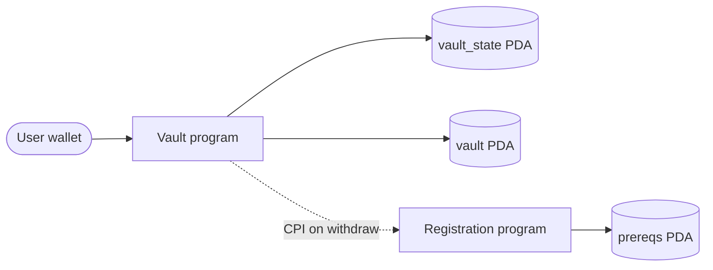
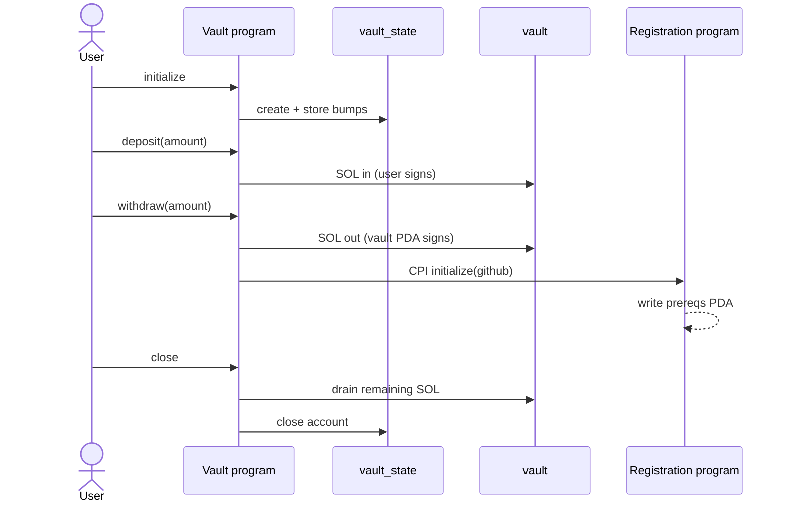

# Pre-Req Vault — Architecture

## System

## Accounts

| Account | Seeds | Holds |
|---------|--------|--------|
| `vault_state` | `["state", user]` | bumps |
| `vault` | `["vault", vault_state]` | SOL |
| `application_account` | `["prereqs", user]` under registration | GitHub username |

## Instruction flow

## Notes

- Programs hold no state; accounts do.
- Vault PDA has no private key — withdraw/close use program signer seeds.
- Registration CPI runs only after a successful withdraw transfer.
